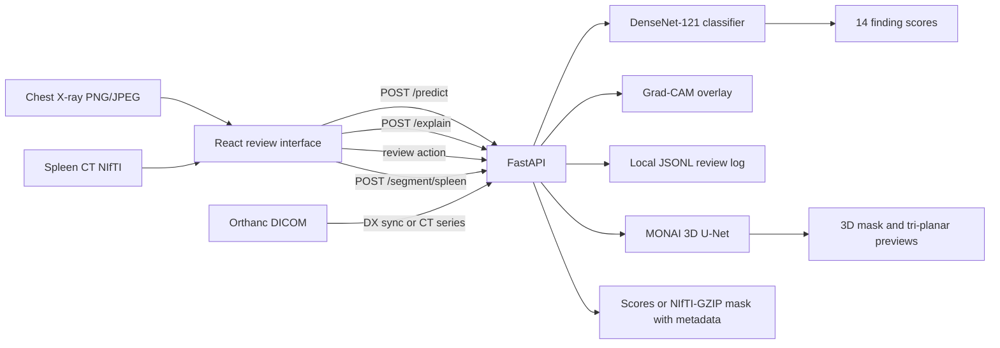

# Medical Imaging AI Review Platform

**Nexvia Technologies · AIML-02**

**Live demo:** [ram15x-medical-imaging-ai-review.hf.space](https://ram15x-medical-imaging-ai-review.hf.space/) · [Hugging Face Space page](https://huggingface.co/spaces/Ram15x/medical-imaging-ai-review)

An educational medical-imaging application with two independent workflows: chest X-ray finding classification and 3D spleen segmentation from CT. The system combines pretrained deep-learning models with a browser review interface, API services, visual overlays, and an Orthanc integration path.

## System at a glance



The chest and CT pathways are separate models and do not form a joint multimodal network. See [the architecture guide](docs/architecture.md) and [the API reference](docs/api.md).

## Main capabilities

- **Chest X-ray classification:** DenseNet-121 produces 14 sigmoid scores for NIH ChestX-ray14 findings. The UI can display a coarse Grad-CAM overlay and save a local demonstration review action.
- **Spleen CT segmentation:** MONAI 3D U-Net processes a NIfTI volume and returns a binary mask with tri-planar previews.
- **DICOM workflow:** Orthanc routes support DX synchronization and CT-series ingestion into the segmentation workflow. CT masks are saved as NIfTI-GZIP with local metadata and retrieval routes.
- **Web and API:** React provides image upload and review screens; FastAPI serves prediction, explanation, segmentation, review, and Orthanc routes.
- **Deployment:** Docker Compose runs the API and web interface. The separate [hosted Gradio demo](https://huggingface.co/spaces/Ram15x/medical-imaging-ai-review) presents the two model paths in a compact interface.

## Model results

The API classifier is a DenseNet-121 weight average of the 8k and 10k checkpoints with BatchNorm recalibration. The table compares it with the earlier 8k reference checkpoint (6c32). Metrics are macro AUROC and macro average precision (AP), averaged over labels with at least 30 positive patients in the stated panel.

| Development panel | Model | Macro AUROC | Macro AP | Labels |
|---|---|---:|---:|---:|
| 5,000 patients | 6c32 reference | 0.7755 | 0.1519 | 13 |
| 5,000 patients | API classifier | 0.7953 | 0.1594 | 13 |
| 2,138 patients | 6c32 reference | 0.7700 | 0.2093 | 9 |
| 2,138 patients | API classifier | 0.7926 | 0.2258 | 9 |

Both panels were used during development and model comparison. NIH labels are report-mined; the scores are uncalibrated and should be read as model-ranking results for these development cohorts, not as clinical probabilities.

The MONAI 3D U-Net was trained on 29 labeled CT volumes, with six volumes used for validation and six reserved as an internal held-out set (seed-42, case-level split). On the six held-out cases the baseline checkpoint reached a mean per-case Dice of **0.3272**, with one case at 0.0963. Segmentation quality is weak and highly variable, and these results describe a small development cohort, not clinical performance. See [the model card](docs/model_card.md) for context and per-model boundaries.

## Data and versioning

The project uses NIH ChestX-ray14 for chest classification and Medical Segmentation Decathlon Task09 Spleen for CT segmentation. DVC pointer files record the retained demonstration examples and the project includes the trained inference checkpoints. Dataset files are managed separately from the application package and remain subject to their source terms. The DVC workflow and data roles are described in [the data guide](docs/data_inventory.md).

## Run the application locally

Model checkpoints are provided in `artifacts/`. Copy `.env.example` to `.env` before starting the app.

### Option A: Docker Compose

Install Docker Desktop and start its Linux engine. From the project root:

```powershell
Copy-Item .env.example .env
docker compose up --build
```

Open the web app at `http://localhost:15180` and API health at `http://localhost:18080/health`. Stop with `Ctrl+C` or run `docker compose down`. Docker uses CPU-only PyTorch; the native Windows configuration uses the CUDA 12.8 PyTorch wheels.

### Option B: Windows, Python, and Node.js

Use Python 3.10 and Node.js 20 or later. From the project root:

```powershell
Copy-Item .env.example .env
py -3.10 -m venv .venv
& .\.venv\Scripts\Activate.ps1
python -m pip install --upgrade pip
python -m pip install -r requirements-windows-tested.txt
python -m pytest -q
```

Start the API in one PowerShell window:

```powershell
& .\.venv\Scripts\Activate.ps1
python -m uvicorn api.app:app --env-file .env --host 127.0.0.1 --port 18080
```

Start the web interface in a second window:

```powershell
Set-Location .\web
npm ci
$env:VITE_API_URL = "http://127.0.0.1:18080"
npm run dev -- --host 127.0.0.1 --port 15180
```

Then open `http://127.0.0.1:15180`. The shipped checkpoints are already in `artifacts/`; settings for model paths and API behavior are documented in `.env.example`.

## Project documents

- [System architecture](docs/architecture.md)
- [API routes and outputs](docs/api.md)
- [Data and DVC guide](docs/data_inventory.md)
- [Model card and evaluation context](docs/model_card.md)
- [Presentation guide](docs/presentation-outline.md)
- [Hosted Gradio demo](https://huggingface.co/spaces/Ram15x/medical-imaging-ai-review)

**Educational prototype only. It is not intended for diagnosis, treatment, or clinical decision-making. Do not upload identifiable patient data.**
See [the project results summary](reports/project_results.md) for the deployed-model metrics and end-to-end output flow.
