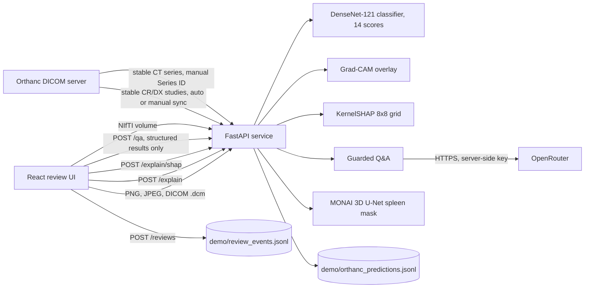

# Medical Imaging AI Review Platform

**Nexvia Technologies · AIML-02 capstone · Educational prototype**

**Hosted demo:** [ram15x-medical-imaging-ai-review.hf.space](https://ram15x-medical-imaging-ai-review.hf.space/). The hosted copy may not match this commit; the local Docker run is the reference.

Two separate models share one review interface:

- **Chest X-ray findings:** DenseNet-121 gives 14 uncalibrated scores for NIH ChestX-ray14 labels, with a Grad-CAM overlay.
- **Spleen CT segmentation:** a MONAI 3D U-Net returns a binary mask from a NIfTI volume or a stable Orthanc CT series.

> Not for diagnosis or clinical decisions. Use only de-identified or public sample data.

## Architecture



Full description: [docs/architecture.md](docs/architecture.md).

## Features

| Area | What it does |
|---|---|
| Chest X-ray classification | 14 sigmoid scores per image, PNG, JPEG or single-frame CR/DX DICOM |
| Grad-CAM | Coarse overlay for a selected label. Not a segmentation mask. |
| SHAP | KernelSHAP on an 8×8 grid for a selected label: signed overlay and the five most influential regions. About 15–20 s on CPU. Sampled, with a fixed seed and an additivity check. |
| Question answering | Optional OpenRouter-backed Q&A about one stored result, for patients or clinicians. Uses only the scores and SHAP regions, adds a safety footer, and answers urgent-symptom wording with an emergency message. Needs `OPENROUTER_API_KEY`. |
| Spleen segmentation | Binary mask, tri-planar previews, NIfTI-GZIP download |
| Orthanc | Pulls stable CR/DX studies automatically (`ORTHANC_AUTO_SYNC_SECONDS`) or on demand; segments a stable CT series |
| Review | "Approve (demo only)", "Reject output", "Needs review". Each action is logged with the model checkpoint hash. |

## Results

Classifier results on the 999-image NIH sample (549 patients): macro AUROC 0.797, macro average precision 0.151, micro F1 at 0.5 0.256. Per-label and subgroup tables, with patient-level intervals, are in [docs/results.md](docs/results.md). They are generated from the pipeline outputs.

Spleen: the served checkpoint's own metadata records a validation mean Dice of 0.833. Its held-out performance is not measured in this repository. See [docs/limits_and_bias.md](docs/limits_and_bias.md).

## Documentation

- [Architecture](docs/architecture.md)
- [API](docs/api.md)
- [DICOM](docs/dicom.md)
- [Data and DVC](docs/data_and_dvc.md)
- [Results](docs/results.md)
- [Limits and bias](docs/limits_and_bias.md)
- [Test results](docs/test_results.md)

## Run locally with Docker

Requires Docker Desktop with the Linux engine.

```bash
cp .env.example .env
docker compose up --build
```

- Web app: http://localhost:15180
- API health: http://localhost:18080/health

Optional Orthanc DICOM test server:

```bash
docker compose --profile orthanc up -d
```

Orthanc listens on `127.0.0.1:18042` (HTTP) and `127.0.0.1:14242` (DICOM). Set `ORTHANC_PASSWORD` in `.env` first. The API polls Orthanc every `ORTHANC_AUTO_SYNC_SECONDS` seconds (60 by default; `0` disables it).

## Run locally without Docker

Python 3.10 or later, Node.js 20 or later.

```bash
python -m venv .venv && source .venv/bin/activate
pip install -r requirements.txt
python -m pytest -q

python -m uvicorn api.app:app --env-file .env --host 127.0.0.1 --port 18080
cd web && npm ci && VITE_API_URL=http://127.0.0.1:18080 npm run dev -- --port 15180
```

Checkpoints are in `artifacts/`.

## Reproduce the classifier evaluation

```bash
dvc pull      # 999 NIH sample images, from the DVC remote
dvc repro     # manifest, bootstrap evaluation, subgroup table
python tools/make_results_doc.py   # regenerate docs/results.md from those outputs
```

## Data

- **NIH ChestX-ray14:** public dataset. The 999-image official-test sample is tracked by DVC; the manifest and protocol are in git.
- **Medical Segmentation Decathlon Task09 (Spleen):** public dataset, not included in this repository.
- **DICOM:** the public datasets are PNG (NIH) and NIfTI (MSD). DICOM is handled by upload and by the Orthanc connector. Tests use DICOM files generated from NIH images, and one public CT series reported in an earlier run. See [docs/dicom.md](docs/dicom.md).

## Limitations

- Labels are mined from radiology reports and are noisy.
- Scores are uncalibrated and are not diagnostic probabilities. At threshold 0.5 most positives are missed.
- Performance is lower for patients aged 60 and over in the NIH sample (see [docs/limits_and_bias.md](docs/limits_and_bias.md)).
- The spleen model's held-out performance is not measured here.
- Orthanc CT completion relies on an instance count that a person enters when Orthanc reports the series as Unknown.
- Orthanc is not a full PACS integration, and no DICOM SEG or SR is written back.
