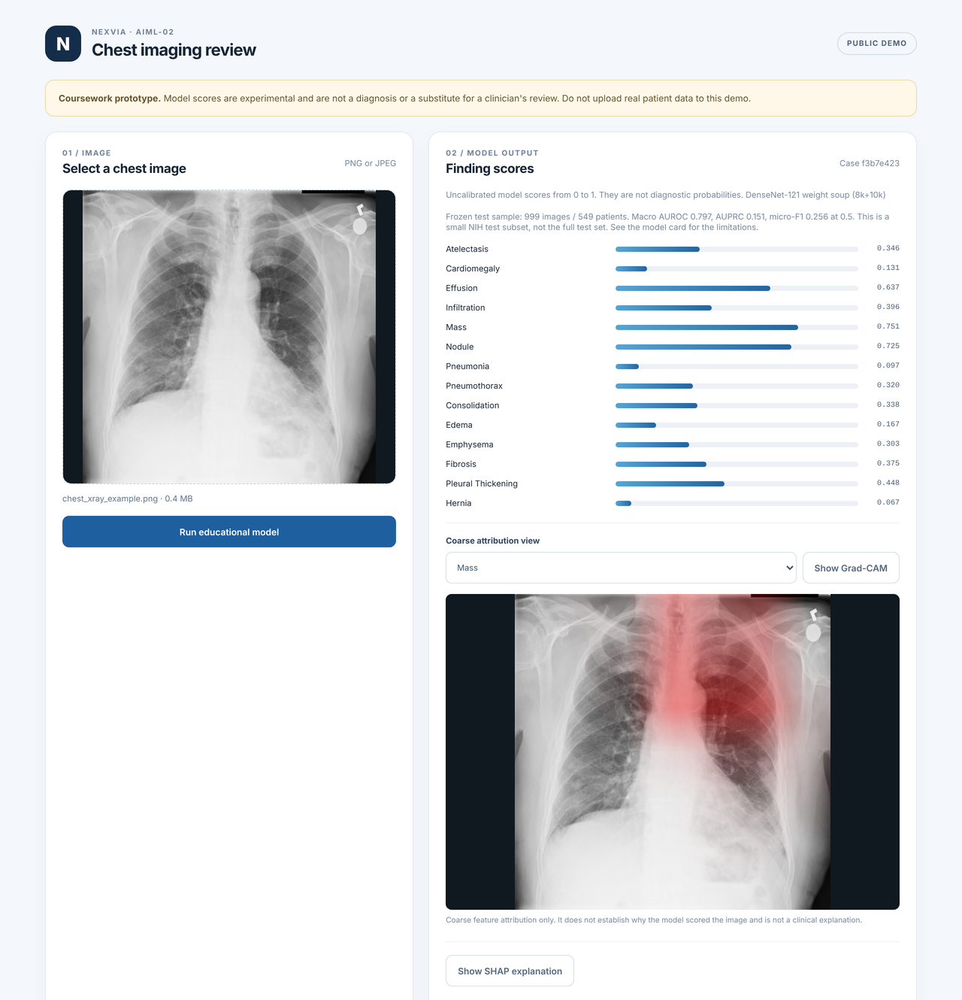
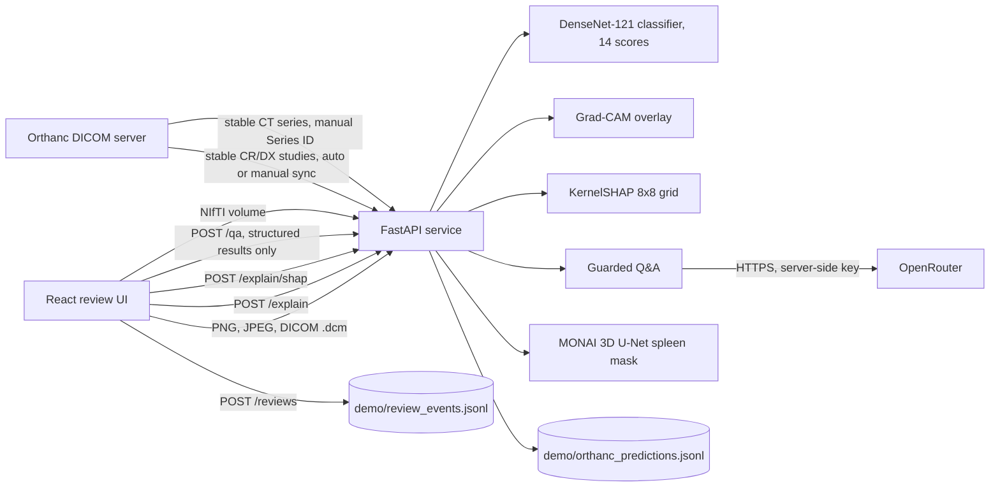

# Medical Imaging AI Review

An educational prototype that scores chest X-rays and segments the spleen on CT, then puts the output in front of a reviewer who can approve or reject it. It was built for the Nexvia Technologies AI/ML internship (project AIML-02).

**Public demo:** [ram15x-medical-imaging-ai-review.hf.space](https://ram15x-medical-imaging-ai-review.hf.space/). It is a lighter Gradio front end over the same model code, with the chest X-ray scores and the spleen segmentation only. Grad-CAM, SHAP, the review log, the Q&A panel and Orthanc are in the full app below.

> Not for diagnosis or any clinical decision. Use public or de-identified images only.



## What it does

Two separate models share one review screen. They don't share weights or data.

- **Chest X-ray findings.** An ImageNet-pretrained DenseNet-121, fine-tuned on NIH ChestX-ray14 (transfer learning), gives 14 scores (the NIH ChestX-ray14 labels) for a PNG, JPEG or single-frame DICOM. A Grad-CAM overlay and a sampled SHAP view show which regions moved a score.
- **Spleen segmentation.** A MONAI 3D U-Net takes a NIfTI CT volume and returns a binary mask with axial, coronal and sagittal previews.
- **Review and audit.** A reviewer can mark a result "Approve (demo only)", "Reject output" or "Needs review". Every action is appended to a log with the hash of the model file that produced the result.
- **Optional extras.** A guarded Q&A panel (needs an `OPENROUTER_API_KEY`) answers questions about one result using only its scores. An Orthanc connector pulls new chest radiographs and CT series from a local DICOM server.

## How well does it work?

These are small samples. Read the numbers with that in mind.

| Model | Data it was measured on | Result |
|---|---|---|
| Chest X-ray classifier | 999 NIH images from 549 patients | Macro AUROC 0.797, macro average precision 0.151, micro F1 0.256 at a 0.5 threshold |
| Spleen segmentation | 6 held-out CT cases the model never trained or was selected on | Mean Dice 0.877 as served (per case 0.81 to 0.94). Raw network output alone: 0.715 |

What to keep in mind:

- At the 0.5 threshold the classifier finds about half of the positives (micro recall 0.48) and most of its flags are wrong (micro precision 0.17). The scores are not calibrated probabilities.
- Performance is lower for patients aged 60 and over (macro AUROC 0.709, against 0.822 for under-40s). The cause was not investigated.
- The served spleen mask keeps only the largest connected 3D blob. That step was chosen on the 6 validation cases (Dice 0.736 to 0.880) and then measured on the 6 test cases (0.715 to 0.877). The test cases had already been scored once without it, so 0.877 is not a fresh blind estimate. It improved all 12 cases, but it can't fix a mask whose largest blob is the wrong organ.
- The spleen figure comes from six cases, so it could move a lot with different cases. Without the clean-up, two of the six were clearly over-segmented. Validation Dice jumped between 0.28 and 0.74 from one epoch to the next near the end of training.
- NIH labels are mined from radiology reports and are noisy.

Per-label tables with patient-level confidence intervals are in [docs/results.md](docs/results.md). The spleen split, run summary and per-case results are in [results/spleen](results/spleen). More on limits and bias: [docs/limits_and_bias.md](docs/limits_and_bias.md).

## How it fits together



Details: [docs/architecture.md](docs/architecture.md) and [docs/api.md](docs/api.md). The model code lives in `api/modeling.py` and the training and evaluation scripts at the repository root. DVC tracks the NIH sample images (`dvc.yaml`, [docs/data_and_dvc.md](docs/data_and_dvc.md)).

## Run it with Docker

You need Docker Desktop. From the repository root:

```bash
cp .env.example .env        # copy .env.example .env on Windows
docker compose up --build
```

- Web app: http://localhost:15180
- API health: http://localhost:18080/health

To check the build end to end (start the stack, call `/health` and `/predict`, confirm the API runs as a non-root user and no `.env` or data folder is inside the image, then shut it down):

```powershell
powershell -ExecutionPolicy Bypass -File scripts/smoke_docker.ps1
```

For the optional Orthanc DICOM server, set `ORTHANC_PASSWORD` in `.env`, then run `docker compose --profile orthanc up -d`. Orthanc listens on `127.0.0.1:18042` (HTTP) and `127.0.0.1:14242` (DICOM). The API checks it every `ORTHANC_AUTO_SYNC_SECONDS` seconds (60 by default, `0` turns it off).

To check the Orthanc path end to end on your own stack, build the fixtures once and run the check (it uploads three radiographs and a 41-slice CT series, then verifies the API's scores, the spleen mask and the audit entry):

```bash
python tools/make_live_fixtures.py --nih-images <folder with the NIH PNGs> --spleen-nifti <spleen_9.nii.gz> --out demo/live_fixtures
python tools/live_orthanc_check.py --fixtures demo/live_fixtures
```

The last run passed 14 of 14 checks on Docker Desktop (`results/live_orthanc_check.json`).

## Run it without Docker

Python 3.10 or later and Node.js 20 or later.

```bash
python -m venv .venv && source .venv/bin/activate
pip install torch torchvision          # CPU wheels are fine; Docker uses requirements-torch-cpu.lock.txt
pip install -r requirements-api.txt pytest
python -m pytest -q

python -m uvicorn api.app:app --env-file .env --host 127.0.0.1 --port 18080
cd web && npm ci && VITE_API_URL=http://127.0.0.1:18080 npm run dev -- --port 15180
```

The two model files are in `artifacts/`.

If Orthanc sync or CT segmentation answers 500 with `PermissionError` under Docker, the files in `demo/` were created by a different user. Move the old `demo/orthanc_*` files and `demo/orthanc_masks/` aside and the API will recreate them.

## Tests

`python -m pytest -q` runs 100 tests. On a clean checkout 96 pass and 4 skip (checked on a fresh clone, Python 3.13, CPU): three need the NIH sample images (`dvc pull`) and one needs the demo image. `python tools/check_baseline.py results/nih_sample/per_label_intervals.json` fails if a new evaluation of the classifier falls below the frozen baseline in `results/nih_sample/baseline.json`. What the tests cover, and what they don't, is in [docs/test_results.md](docs/test_results.md).

## Reproduce the numbers

Classifier (needs the DVC remote for the 999 images):

```bash
dvc pull
dvc repro                           # manifest, bootstrap evaluation, subgroup table
python tools/make_results_doc.py    # regenerate docs/results.md
```

Spleen (download MSD Task09 from medicaldecathlon.com first):

```bash
python train_segmentation.py --dataset-json <dataset.json> --dataset-root <folder> --output <run_dir> --epochs 60
python evaluate_segmentation.py --dataset-json <dataset.json> --dataset-root <folder> \
    --split results/spleen/case_split.json --checkpoint artifacts/best_spleen_unet_20261109.pt --output <result.json>
```

## Tech stack

| Area | Tools |
|---|---|
| Models | PyTorch, torchvision DenseNet-121 (ImageNet-pretrained, fine-tuned), MONAI 3D U-Net |
| Explainability | Grad-CAM, KernelSHAP |
| Data and versioning | NIH ChestX-ray14, MSD Task09 Spleen, pydicom, DVC |
| Backend | FastAPI, audit log in JSONL with model SHA-256 |
| Imaging server | Orthanc (Docker Compose profile) |
| Frontend | React 19, Vite |
| Packaging and demo | Docker Compose, Gradio on a Hugging Face Space |
| Testing | pytest (96 pass, 4 skipped), live Orthanc check |

## Security notes

- Secrets stay in `.env`, which git ignores. The Docker images run as a non-root user and exclude `.env`, data and training volumes.
- Uploads have size and pixel limits, and checkpoints load with `weights_only=True`.
- The API has no user accounts. For a public deployment, `deploy/hf-space/Dockerfile` builds a single container (API plus UI) for any Docker host, with request guards switched on: Orthanc routes are disabled, POST requests are rate-limited per client, and the Q&A route (which spends API credit) has a stricter hourly cap. See `api/guards.py`. The public Space above uses a Gradio front end instead of that container, because its account cannot run Docker Spaces; its source and deploy notes are in `deploy/hf-space-gradio/`.
- Dependencies are pinned in `requirements-api.lock.txt` and checked with `pip-audit`.

## Data

- **NIH ChestX-ray14:** public. The 999-image sample is tracked with DVC; the manifest and protocol are in git.
- **Medical Segmentation Decathlon, Task09 Spleen:** public, not included here.
- **DICOM:** the public sets are PNG and NIfTI. DICOM comes in through upload and the Orthanc connector; tests use DICOM files generated from NIH images, and the Orthanc path has a live end-to-end check (`tools/live_orthanc_check.py`, results in `results/live_orthanc_check.json`). See [docs/dicom.md](docs/dicom.md).

