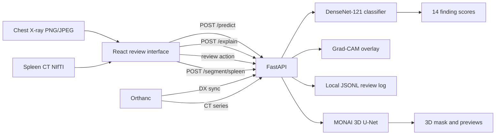

# Medical Imaging AI Review Platform

**Nexvia Technologies · AIML-02 capstone · Educational prototype**

**Live demo:** [ram15x-medical-imaging-ai-review.hf.space](https://ram15x-medical-imaging-ai-review.hf.space/) · [Hugging Face Space](https://huggingface.co/spaces/Ram15x/medical-imaging-ai-review)

An educational pipeline with two independent models and a browser review interface:

- **Chest X-ray findings:** a DenseNet-121 classifier produces 14 uncalibrated scores for NIH ChestX-ray14 labels, with a Grad-CAM overlay.
- **Spleen CT segmentation:** a MONAI 3D U-Net returns a binary mask from a NIfTI volume or a stable single-series Orthanc CT.

The two models are separate and are not combined.

> Not for diagnosis or clinical decisions. Use only de-identified or public sample data.

## Architecture



Details: [architecture](docs/architecture.md) · [API routes](docs/api.md) · [data and DVC](docs/data_inventory.md) · [model card](docs/model_card.md).

## Features

| Area | What it does |
|---|---|
| Chest X-ray classification | 14 sigmoid scores per image with Grad-CAM (coarse attribution only) |
| Spleen segmentation | Binary mask, tri-planar previews, NIfTI-GZIP download |
| Orthanc integration | Syncs single-frame CR/DX radiographs to the classifier; segments a stable CT series |
| Review log | Records a reviewer action with the model name and checkpoint SHA-256 |
| Hosting | Docker Compose for local runs; Hugging Face Space for the hosted demo |

## Results

All figures below come from runs saved in this repository's documentation.

**Chest X-ray classifier, 999-image subset of the NIH official test split** (549 patients, fixed threshold 0.5, [full report](docs/evaluation_nih_test_sample.md)):

| Metric | Value |
|---|---:|
| Macro AUROC (13 labels with defined AUROC) | 0.7967 |
| Macro AUPRC | 0.1507 |
| Micro F1 at 0.5 | 0.2565 |

Patient-level 95% intervals for every label are in the report. Labels with few positives have very wide intervals.

**Spleen segmentation, MSD Task09:** the served checkpoint (`best_spleen_unet_candidate_20261103.pt`) has no independently verified held-out Dice in this repository. Two saved results conflict and are not reconciled: an earlier baseline (threshold 0.80, 64³ patches) reported mean per-case Dice 0.3272 on six held-out cases (one at 0.0963), while the served checkpoint's saved summaries report 0.8327 on validation cases and 0.7883 on a repeated holdout whose cases had prior project use. Treat segmentation quality as unestablished; the model should not be used for clinical segmentation.

## Run locally with Docker

Requires Docker Desktop with the Linux engine.

```bash
cp .env.example .env
docker compose up --build
```

- Web app: http://localhost:15180
- API health: http://localhost:18080/health

**Data formats.** The public datasets are not DICOM: NIH ChestX-ray14 images are PNG, and MSD Task09 volumes are NIfTI. DICOM enters the system only through the optional Orthanc connector (DX/CR synchronization and manual CT-series conversion). The DX path was tested with a generated synthetic study. The CT path was tested with a generated synthetic series and one public de-identified 81-slice TCIA CT series, which needed an operator-supplied instance count because Orthanc reported its status as Unknown. These tests check interoperability only, not accuracy or broad DICOM compatibility.

Optional Orthanc (DICOM test server):

```bash
docker compose --profile orthanc up -d
```

Orthanc listens on `127.0.0.1:18042` (HTTP) and `127.0.0.1:14242` (DICOM). Set `ORTHANC_PASSWORD` in `.env` first.

## Run locally without Docker

Python 3.10 or later, Node.js 20 or later.

```bash
python -m venv .venv && source .venv/bin/activate
pip install -r requirements-windows-tested.txt
python -m pytest -q

python -m uvicorn api.app:app --env-file .env --host 127.0.0.1 --port 18080
cd web && npm ci && VITE_API_URL=http://127.0.0.1:18080 npm run dev -- --port 15180
```

Model checkpoints are in `artifacts/`.

## Tests

```bash
python -m pytest -q
```

## Data

- **NIH ChestX-ray14:** public dataset, used for chest X-ray labels. Images are not in this repository.
- **Medical Segmentation Decathlon Task09 (Spleen):** public dataset, used for CT segmentation.

Raw data is excluded from version control. DVC pointer files describe the retained examples. See [the data guide](docs/data_inventory.md).

## Limitations

- Labels are mined from radiology reports and are noisy.
- Scores are uncalibrated and are not diagnostic probabilities.
- Grad-CAM is a coarse visual aid and does not show how the model reasons.
- The spleen model's held-out performance is weak.
- The Orthanc connector handles one stable single-frame instance per series and is not a full PACS integration.

## Project documents

- [Architecture](docs/architecture.md)
- [API](docs/api.md)
- [Data and DVC](docs/data_inventory.md)
- [Model card](docs/model_card.md)
- [Evaluation on the NIH test sample](docs/evaluation_nih_test_sample.md)
- [Results summary](reports/project_results.md)
