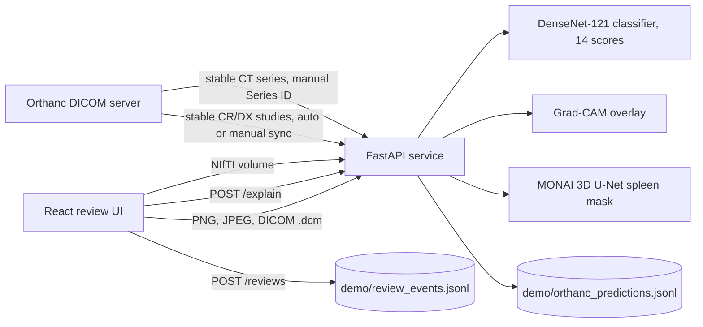

# Architecture

Two separate model pipelines share one review application. They do not share weights or data.

## Components

| Component | Location | Role |
|---|---|---|
| Classifier | `api/modeling.py`, `artifacts/best_densenet121.pt` | DenseNet-121 with a 14-output sigmoid head. Input is RGB, resized to 224×224, ImageNet-normalised. Output scores are uncalibrated. |
| Grad-CAM | `gradcam.py`, `POST /explain` | Coarse region overlay for one selected label. Not a segmentation mask and not evidence of reasoning. |
| Spleen segmenter | `segment_spleen.py`, `artifacts/best_spleen_unet_candidate_20261103.pt` | MONAI 3D U-Net, 96³ sliding-window ROI, threshold 0.50, flip TTA off by default. |
| DICOM conversion | `api/orthanc.py` (`dicom_bytes_to_image`), `api/ct_series.py` | Converts single-frame CR/DX objects to images and stable CT series to NIfTI with geometry checks. |
| Orthanc connector | `api/orthanc.py`, `api/app.py` | Reads stable-study changes, classifies CR/DX, stores results. Pull runs on demand or on `ORTHANC_AUTO_SYNC_SECONDS`. |
| Review log | `POST /reviews` | Append-only JSONL audit of reviewer actions, with the model checkpoint hash. |
| React UI | `web/src/main.jsx` | Uploads, scores, overlay, and review buttons: "Approve (demo only)", "Reject output", "Needs review". |

## Model lifecycle

- The classifier and spleen checkpoints are loaded lazily on first use. `GET /health` reports whether each is present and loaded.
- Checkpoint SHA-256 hashes are included in every prediction and review record, so a result can be traced to a file.

## Scope

This is an educational prototype. It does not write DICOM SEG or SR objects back to Orthanc, and it is not a PACS.
