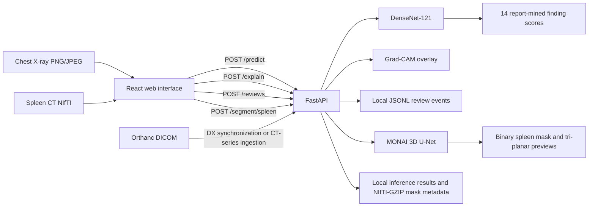

# System architecture

The Medical Imaging AI Review Platform combines separate chest X-ray and spleen CT inference workflows with a browser interface, API layer, local review records, and optional Orthanc connectivity.

## End-to-end flow

The two model paths are independent: the classifier handles 2D radiographs, while the segmenter processes 3D CT volumes. Orthanc provides an input route into those workflows; it does not combine or retrain the models.

## Models and outputs

### Chest X-ray

A DenseNet-121 encoder produces 14 finding scores for NIH ChestX-ray14 labels. The deployed checkpoint is `artifacts/best_densenet121.pt`, an equal-weight average of the 8k and 10k DenseNet checkpoints with BatchNorm recalibration. The model returns uncalibrated sigmoid scores. Grad-CAM displays coarse image regions associated with a selected score; it is not a localization mask.

### Spleen CT

A MONAI 3D U-Net produces a binary spleen mask from a NIfTI volume. The API uses a 96×96×96 sliding-window ROI, threshold 0.50, and disabled flip TTA. The checkpoint is `artifacts/best_spleen_unet_candidate_20261103.pt` (SHA-256 `46622de72ac91c7e17d36da19d1088e90e1ad836a0d6e00533b37b805b5cb7a4`). Results include a mask and tri-planar previews.

## Application components

| Layer | Components | Role |
|---|---|---|
| Browser | React in `web/` | Uploads images and volumes, presents model outputs and overlays, and records demonstration review actions. |
| API | FastAPI in `api/app.py` | Serves health, prediction, explanation, segmentation, review, and Orthanc routes. |
| Classification | DenseNet-121 in `api/modeling.py` | Returns 14 chest X-ray finding scores. |
| Attribution | Grad-CAM in `api/app.py` | Creates a coarse attribution overlay for a selected classifier output. |
| Segmentation | MONAI 3D U-Net in `segment_spleen.py` | Processes 3D CT input and returns a spleen mask with previews. |
| DICOM connection | Orthanc integration in `api/orthanc.py` and `api/ct_series.py` | Synchronizes eligible DX images and converts CT series into the spleen segmentation input path. |
| Local persistence | JSONL logs and NIfTI-GZIP files | Stores demonstration review events, inference summaries, and CT mask outputs. |
| Deployment | Docker Compose | Starts the API and web interface; Docker uses CPU-only PyTorch. |

For Orthanc CT, complete-series status is used when available. If Orthanc reports `Unknown`, the route accepts an independently supplied expected instance count and checks it against the retrieved series count before processing. The count is a completeness check input, not a clinical quality assessment. Masks and provenance metadata are saved locally as NIfTI-GZIP and JSONL; the workflow does not write DICOM SEG/SR objects back to Orthanc.

## Evaluation snapshot

The classifier’s macro AUROC/AP on the 5,000-patient development panel was 0.7953/0.1594 across 13 labels with at least 30 positive patients. On the 2,138-patient common-clean panel it was 0.7926/0.2258 across 9 labels with that support. The earlier 8k reference scored 0.7755/0.1519 and 0.7700/0.2093, respectively. Panels were reused during development; labels are report-mined.

The spleen checkpoint was selected using six validation cases. On six reserved internal held-out cases it reached mean per-case Dice 0.3272, with one case at 0.0963. These figures are development results for this prototype, not clinical validation.

## Run and configuration

Use `docker compose up --build` for the containerized application or the native setup in the root README. `.env.example` lists the checkpoint paths, preprocessing and segmentation settings, service ports, and optional Orthanc settings. The API health response exposes active model metadata.

**Educational prototype only; not for diagnosis or treatment.**