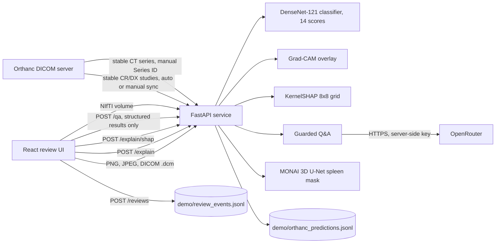

# Architecture

Two separate model pipelines share one review application. They do not share weights or data.

Rendered image: 

## Components

| Component | Location | Role |
|---|---|---|
| Classifier | `api/modeling.py`, `artifacts/best_densenet121.pt` | DenseNet-121 with a 14-output sigmoid head. Input is RGB, resized to 224×224, ImageNet-normalised. Output scores are uncalibrated. |
| Grad-CAM | `gradcam.py`, `POST /explain` | Coarse region overlay for one selected label. Not a segmentation mask and not evidence of reasoning. |
| Spleen segmenter | `segment_spleen.py`, `artifacts/best_spleen_unet_20261109.pt` | MONAI 3D U-Net, 96³ sliding-window ROI, threshold 0.50, flip TTA off by default. |
| DICOM conversion | `api/orthanc.py` (`dicom_bytes_to_image`), `api/ct_series.py` | Converts single-frame CR/DX objects to images and stable CT series to NIfTI with geometry checks. |
| Orthanc connector | `api/orthanc.py`, `api/app.py` | Reads stable-study changes, classifies CR/DX, stores results. Pull runs on demand or on `ORTHANC_AUTO_SYNC_SECONDS`. |
| Review log | `POST /reviews` | Append-only JSONL audit of reviewer actions, with the model checkpoint hash. |
| React UI | `web/src/main.jsx` | Uploads, scores, overlay, and review buttons: "Approve (demo only)", "Reject output", "Needs review". |

## Model lifecycle

- The classifier and spleen checkpoints are loaded lazily on first use. `GET /health` reports whether each is present and loaded.
- Checkpoint SHA-256 hashes are included in every prediction and review record, so a result can be traced to a file.

## Scope

This is an educational prototype. It does not write DICOM SEG or SR objects back to Orthanc, and it is not a PACS.

## Design notes: what is coupled or fragile

These are known trade-offs of a prototype, found in a review of the service boundaries. None of them is hidden by the code.

- **One large API module.** `api/app.py` (about 970 lines) holds routing, model loading, Orthanc sync, the Q&A call and review logging. It works and is covered by tests, but it is harder to change safely than separate modules would be. Splitting it by area is the next refactor.
- **State lives in local JSONL files.** Review events, Orthanc results and sync state are appended to files under `demo/`. Locks protect them inside one process only, so running several workers against the same folder is unsafe, and a hosted container loses them on restart.
- **One model lock.** Inference is serialised by a process-wide lock. That is fine for a demo and means concurrent users queue.
- **Hand-copied numbers in the UI.** The evaluation figures shown under the scores (`FROZEN_EVALUATION` in `web/src/main.jsx`) are copied from `results/nih_sample/baseline.json` and only appear when the served checkpoint hash matches. If the checkpoint changes, they must be updated together; there is no shared schema.
- **No user accounts.** Anyone who reaches the API can call it. The hosted image limits damage with the request guards in `api/guards.py` (Orthanc routes off, per-client rate limits, a stricter hourly cap on `/qa`). The counters are in memory and per process.
- **Orthanc paths are untested against a live server.** Only the sync timer has automated tests, so any manual check against a local Orthanc is not repeatable from the test suite.
- **Spleen preview orientation.** Previews use the RAS array order, so the patient's left appears on the image's left. This differs from the usual radiological display and is labelled in the UI.
