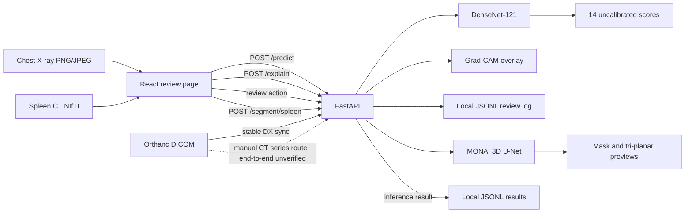

# Architecture and verification

This describes the local educational prototype. It is not a clinical system.

## Data flow

The chest and spleen paths are separate. The chest classifier accepts PNG/JPEG and returns 14 report-mined finding scores. Scores are uncalibrated. Grad-CAM provides coarse attribution, not a detection box or clinically faithful explanation. Review buttons append local demonstration events; they do not create a radiologist decision record.

The spleen path accepts 3D NIfTI. The packaged MONAI 3D U-Net uses a 96×96×96 sliding-window ROI; API threshold is 0.50 and flip TTA is disabled. It returns a binary mask and tri-planar previews. The API checkpoint is `artifacts/best_spleen_unet_candidate_20261103.pt`, SHA-256 `46622de72ac91c7e17d36da19d1088e90e1ad836a0d6e00533b37b805b5cb7a4`.

## Components and status

| Component | Implementation | Verification boundary |
|---|---|---|
| Classifier | `api/modeling.py`, `api/app.py`, DenseNet-121 checkpoint `artifacts/best_densenet121.pt` | Live `/predict` and browser upload checks are recorded. Current tests pass in the local CPU Docker test image. |
| Grad-CAM | `api/app.py` and classifier feature hooks | Coarse attribution route was smoke-checked. No clinical explanation claim. |
| Segmentation | `segment_spleen.py`, `api/app.py`, MONAI 3D U-Net checkpoint above | Live HTTP `/segment/spleen` checks are recorded on existing validation cases. The selected validation result is optimistic. |
| API | FastAPI routes for health, prediction, explanation, NIfTI segmentation, local review log, and optional Orthanc | HTTP checks are recorded in the verification reports. |
| Web UI | React in `web/` | Browser uploads and API/web container checks are recorded. The UI is a local demo. |
| Orthanc DX path | Stable-study change sync, single-frame DX inference, local JSONL result | Passed one generated synthetic DX study. This does not verify broad DICOM compatibility or clinical input. |
| Orthanc CT path | Manual CT-series conversion to NIfTI and spleen inference | Not verified live end to end. The recorded synthetic CT case was rejected when Orthanc reported series status `Unknown`; no segmentation inference ran in that check. |
| Docker | Compose API and web services, CPU-only PyTorch image | API and web live HTTP checks are recorded. Docker segmentation uses CPU configuration; the runtime device was not logged in those checks. |
| DVC/data | `dvc.yaml`, `dvc.lock`, audit scripts | Dataset audits and configuration are documented. Full datasets, manifests, and a DVC remote are absent from the release. Training cannot be reproduced from this package alone. |

`.env.example` documents settings. The API logs the segmentation checkpoint path and SHA-256, ROI, threshold, and TTA in startup and health metadata. The packaged checkpoints are under `artifacts/`.

## Evaluation summary

The DenseNet-121 API checkpoint is an 8k/10k equal-weight average with BatchNorm recalibration. On the reused 5,000-patient panel, it scored macro AUROC/AP 0.7953/0.1594 across 13 labels with at least 30 positives; reference 6c32 scored 0.7755/0.1519. On the reused 2,138-patient common-clean panel, it scored 0.7926/0.2258 across 9 such labels; 6c32 scored 0.7700/0.2093. Both panels were reused during comparison and are not independent tests. Labels are report-mined, absolute performance is modest, and AP depends on prevalence.

The spleen model was trained on 29 labeled volumes and selected at epoch 125 using the same six validation cases that produced mean argmax Dice 0.8327. This validation score is optimistic. A repeated six-case internal holdout scored 0.7883 and has prior project evaluation history, so it is not project-wide untouched. Different ROI settings make this unsuitable as a strict old-versus-new improvement claim.

## Use boundary

Educational prototype only. No clinical validation, calibrated diagnostic probabilities, prospective evaluation, or evidence of improved patient outcomes. Do not use for diagnosis or treatment.

## Evidence

- `../reports/classifier_results.md` — classifier panels and comparisons.
- `../reports/project_closeout.md` — training curves and segmentation results.
- `../reports/final_checks.md` — saved case-level API regression checks.
- `../reports/demo_verification.md` — browser, environment, and demo checks.
- `../reports/requirements_and_verification.md` — portal mapping and current test-suite result.
