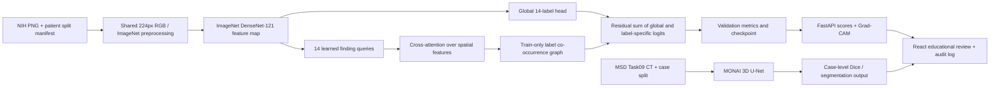

# AIML-02 research architecture and experiment plan

## Portal boundary

The portal fixes the product outcomes and tool family: image classification plus 3D segmentation, patient/case-aware data handling, DVC, DenseNet or EfficientNet transfer learning, MONAI 3D U-Net, Grad-CAM, Orthanc, React review, audit logging, Docker, and an education-only notice. It does not prescribe the internal classifier head or require a two-backbone ensemble. The architecture below stays within the named stack and keeps the test data isolated.

## Product design

The candidate is a single DenseNet visual encoder plus a label-query spatial-attention residual and a training-only graph (`densenet121_label_graph_residual`). Each disease query attends to the encoder's spatial feature tokens; the global DenseNet logits remain the main prediction and the added branch can learn a bounded correction. The graph is derived from positive co-occurrence in the training split only. This is an incremental, testable design—not a claim of a novel architecture.

Keep DenseNet-121 as the baseline and current demo default. A previously tested DenseNet+Swin dual-backbone model was worse on the shard validation screen (macro AUROC 0.6966 vs 0.7480 under non-matched optimization); a matched standalone Swin screen also performed worse. The current data do not support promoting those variants.

## Controlled subset experiment

Use the retained patient-disjoint subset and the same preprocessing, seed, optimizer, batch size, and epoch budget for both models:

- 4,000 train images / 1,891 patients
- 1,779 validation images / 548 patients
- 0 train/validation patient overlap
- 1,492 held-out test images are excluded from model training, selection, and evaluation
- DenseNet-121 baseline versus `densenet121_label_graph_residual`
- ImageNet initialization, seed 42, 3 epochs, batch 4, AdamW learning rate 1e-4

Label support is sparse for important findings: Hernia has 11 train and 5 validation positives; Pneumonia has 34 and 16. This split can screen a hypothesis, but it cannot establish reliable performance for those rare labels.

Report per-label and macro AUROC/AUPRC, micro precision/recall/F1 at the predeclared 0.5 threshold, confusion counts, checkpoint epoch, run time, peak GPU memory, and model size. If the hybrid has a credible validation advantage across both ranking and operating metrics, repeat with at least three seeds before promotion. Otherwise retain DenseNet. Only after architecture, thresholds, and preprocessing are frozen should the held-out test split be evaluated once.

The three-seed comparison is complete. The graph-residual candidate has consistently higher macro AUROC, but AUPRC and thresholded F1 are mixed across seeds. Mean differences are small, and three seeds on one fixed subset do not establish robust superiority. Both seed-42 runs were also extended to ten epochs from their checkpoints; validation metrics fluctuated, and the best-AUROC checkpoints differed by only 0.0014 AUROC. Keep DenseNet as the demo/reference model and retain the graph-residual model as an unpromoted research candidate. Full curves are in `reports/subset_hybrid_comparison_2026-10-28.md`. The comparison drivers are `scripts/run_subset_architecture_comparison.ps1` and `scripts/extend_subset_comparison.ps1`; outputs go to the local data root, not Git. Their commands do not include a test evaluator.

## Explanations and language models

Keep Grad-CAM in the demo as the interactive, coarse attribution required by the brief. Add SHAP only as an offline research analysis on selected validation examples. SHAP's PyTorch `GradientExplainer` implements expected gradients, uses a background set, supports multi-output models, and estimates attributions; it is not a causal explanation or an accuracy improvement. Explain one selected label at a time with a small fixed background and sample budget, record the parameters, and compare it with Grad-CAM and simple occlusion checks. Do not run SHAP over all 14 labels for every API request.

Do not add OpenRouter to the image-inference path. No natural-language or report-generation requirement exists, and sending radiographs to an external model would add a data-egress path without evidence of better classification. There is no API key requirement for the current product.

## Limits

NIH findings are report-mined and noisy. The subset experiment is not a clinical study; fixed-threshold F1 is not accuracy, AUROC is not accuracy, and saliency maps do not validate correctness. The existing demo's DenseNet checkpoint comes from an earlier split and is not to be described as trained on the new 4,000/1,779 subset.

## References

- [Portal project #1 instructions](https://www.nexviatechnologies.in/student/projects)
- [SHAP GradientExplainer documentation](https://shap.readthedocs.io/en/latest/generated/shap.GradientExplainer.html)
- [Lundberg and Lee, A Unified Approach to Interpreting Model Predictions (NeurIPS 2017)](https://papers.neurips.cc/paper/2017/hash/8a20a8621978632d76c43dfd28b67767-Abstract.html)
- [Torchvision DenseNet models and weights](https://docs.pytorch.org/vision/main/models/densenet.html)
